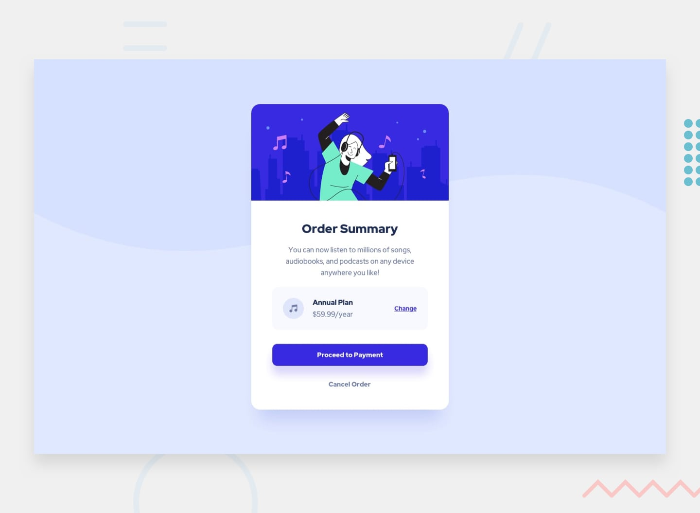

# Frontend Mentor - Order summary card solution

This is a solution to the [Order summary card challenge on Frontend Mentor](https://www.frontendmentor.io/challenges/order-summary-component-QlPmajDUj). Frontend Mentor challenges help you improve your coding skills by building realistic projects.

## Overview

### The challenge

Users should be able to:

- See hover states for all interactive elements on the page

### Screenshot

### Links

- Solution: [github.com/khaledagina/order-summary-component](https://github.com/khaledagina/order-summary-component)
- Live site: [khaledagina.github.io/order-summary-component](https://khaledagina.github.io/order-summary-component/)

## My process

### Built with

- Semantic HTML5 markup
- CSS3
- Flexbox
- Responsive design with media queries

## Author

- GitHub - [@khaledagina](https://github.com/khaledagina)
